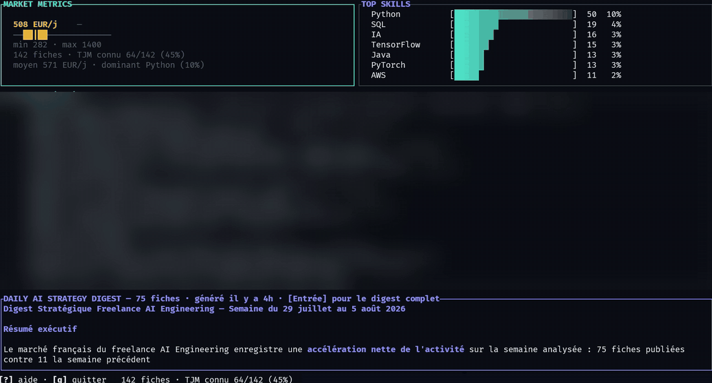

# malt-radar

A distributed **edge/cloud market-intelligence pipeline** with a terminal dashboard, tracking the French AI-freelancing market: daily rates (TJM), requested stacks and trends.

Two goals: a technical showcase (async Rust, edge/cloud architecture, hybrid local + hosted LLM) and a real tool for monitoring my own professional market.



*The live feed of individual job postings is blurred in this recording. Source licences ask not to republish postings, so public demos show aggregated metrics and the generated digest only.*

> **Name note:** the project started as a Malt-focused idea. Malt and LinkedIn are **excluded as data sources** — their terms forbid scraping, manual or automated. The name stayed; no data is collected from either platform. See [`SOURCES.md`](SOURCES.md).

## How it works

```
 VPS (Hetzner)            Raspberry Pi 5              VPS                     Workstation
┌──────────────┐  pull  ┌───────────────┐  push  ┌─────────────┐  HTTP  ┌──────────────┐
│  ingestion   │◄───────│    worker     │───────►│ aggregator  │◄───────│   TUI (Rust) │
│ Python,SQLite│        │ Ollama/Qwen2.5│        │ API + daily │        │ Ratatui/Tokio│
└──────────────┘        └───────────────┘        │ Claude digest│       └──────────────┘
                                                 └─────────────┘
              all machines linked over Tailscale — no public ports
```

1. **`ingestion/`** (Python, `httpx`, SQLite) — collects missions from allowed sources: the Free-Work public JSON API and the official France Travail API. Idempotent upserts.
2. **`worker/`** (Python, Ollama + Qwen 2.5 3B) — extracts structured data (daily rate, stack, duration, level, category) under a strict JSON Schema with Pydantic validation and retry. Writes Markdown notes with YAML frontmatter. Works by **pulling** jobs: the Pi is not guaranteed to be always online, so nothing listens on it.
3. **`aggregator/`** (Python, HTTP API) — serves missions to the worker and notes to the TUI, computes rolling 7-day metrics (median/quartile rates, skill frequency, trend) and generates **one daily digest** with Claude (Haiku). Only aggregated metrics reach the prompt, never individual job ads.
4. **`tui/`** (Rust workspace: `core`, `client`, `app`) — Ratatui dashboard: market metrics, live feed, skills frequency, digest.

## Design decisions

- **Legal-first sourcing.** Each source is checked against its terms and `robots.txt` before any code is written, and recorded in [`SOURCES.md`](SOURCES.md). Polite crawling: identifiable User-Agent, backoff on 429, roughly once a day.
- **France Travail licence.** Data stays private; demos show aggregated metrics, not individual postings.
- **Cost-aware LLM use.** Cheap local model for per-ad extraction, one hosted-model call per day for synthesis (about $0.10–0.15 per month).
- **One service, one machine, own tooling.** Python and Rust services keep separate dependency management.

## Tests and CI

- About 200 automated tests: 123 `pytest` tests across `ingestion`, `aggregator` and `worker`, and 83 Rust tests for the TUI (HTTP mocked with `wiremock`)
- GitHub Actions run all of them on every push and pull request

```bash
make setup-ingestion setup-aggregator setup-worker
make test
```

## Status

Built in a few days as a working prototype. All four components (ingestion, processing, synthesis, dashboard) are implemented and tested, including the TUI digest panel. Systemd units for the VPS and the Pi 5 are included. Not done yet: long-running production validation (extraction accuracy on real data, a week of stable collection), network hardening (Tailscale ACLs, backups), and some TUI extras (stack filter, export, system health). See [`ROADMAP.md`](ROADMAP.md).

## Stack

Python · Rust (Tokio, Ratatui, Reqwest) · SQLite · Ollama · Claude API · Tailscale · systemd · GitHub Actions
